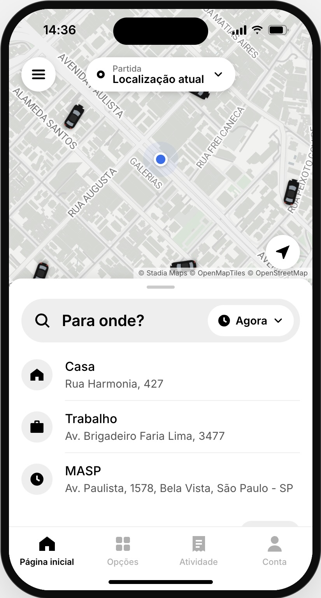
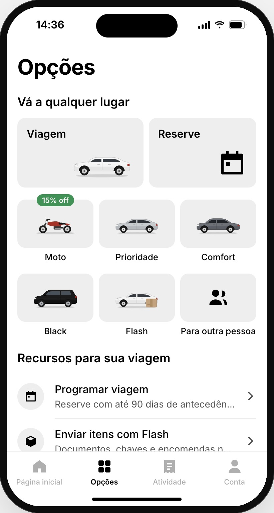
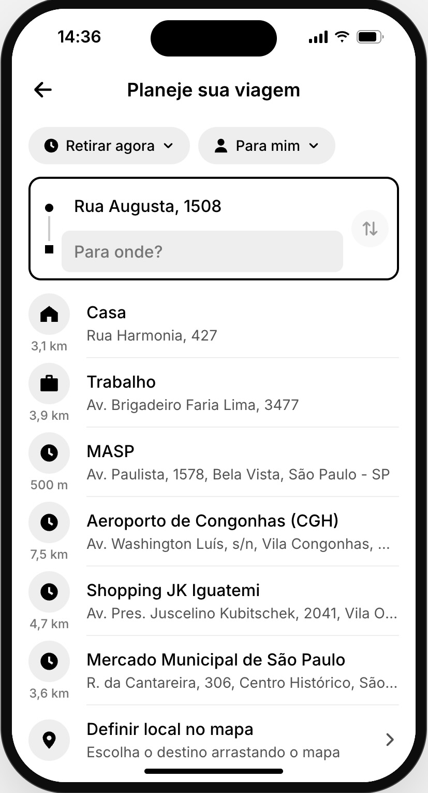
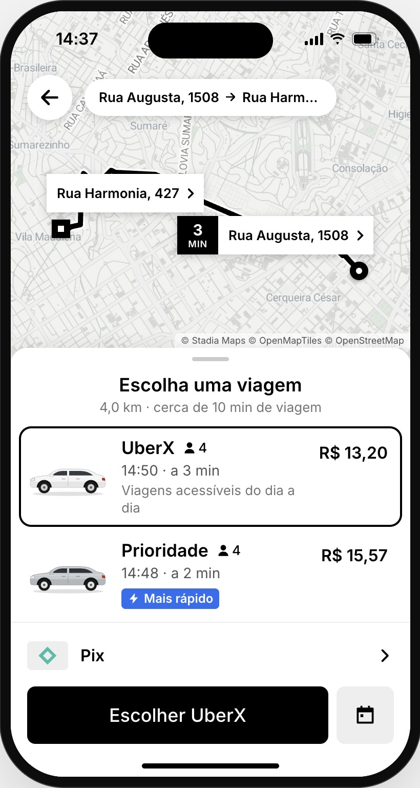
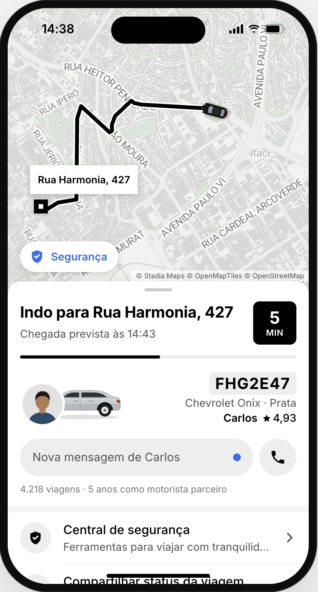
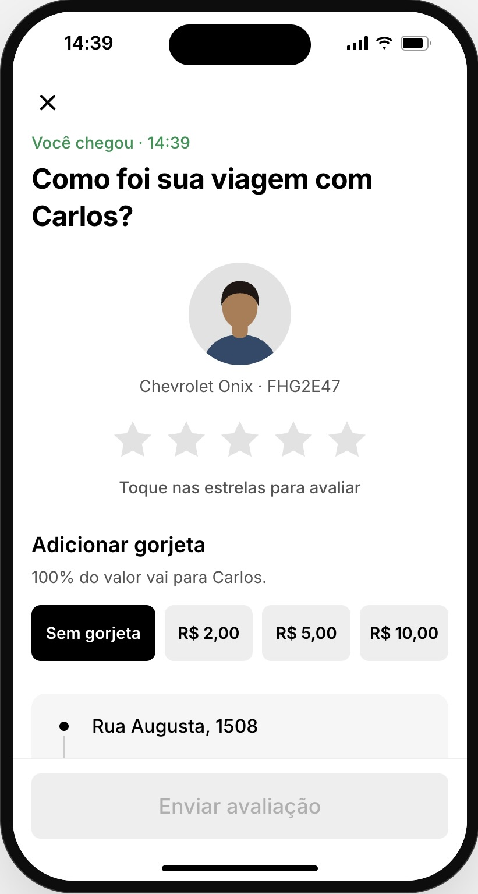

<h1 align="center">
  <br>
  Clone Aplicativo Uber
  <br>
</h1>

<p align="center">
  Réplica navegável da experiência do app de passageiro, feita para a web e pensada primeiro para o celular.
</p>

<p align="center">
  
  
  
  
  
</p>

---

## Sobre o projeto

Este é um **protótipo de interface** do app de passageiro, construído com React e Vite. Ele reproduz o fluxo completo de uma corrida: o usuário escolhe para onde quer ir, compara categorias e preços, acompanha o motorista no mapa e, no fim, avalia a viagem.

Não há backend: motoristas, pagamentos e histórico são simulados. Já o mapa, as rotas e os endereços são reais, vindos do OpenStreetMap e do OSRM. Por isso dá para buscar qualquer rua da Grande São Paulo e ver o trajeto de verdade.

Em telas a partir de 600 px o app aparece dentro de uma moldura de celular. Acima de 1100 px surge um painel lateral com atalhos para cada fluxo.

---

## Funcionalidades

### Antes da viagem

| | |
|---|---|
| **Página inicial** | Mapa com sua localização e carros próximos, "Para onde?", Casa/Trabalho, recentes e sugestões em um painel arrastável |
| **Planeje sua viagem** | Partida e destino editáveis, busca de endereços reais, botão de inverter, viagem para você ou para outra pessoa |
| **Definir no mapa** | Arraste o mapa e o endereço sob o alfinete é atualizado em tempo real |
| **Escolha uma viagem** | Rota real com 6 categorias, preço, horário de chegada e tempo de espera de cada uma |
| **Reservar para depois** | Agende o horário de retirada |
| **Pagamento** | Pix, cartão de crédito ou dinheiro |

### Durante e depois da viagem

| | |
|---|---|
| **Busca de motorista** | Animação de procura até o motorista aceitar |
| **Acompanhamento** | Carro animado sobre a rota, tempo estimado, PIN, dados do motorista, placa e modelo |
| **Chat e ligação** | Converse com o motorista ou simule uma chamada |
| **Segurança** | Compartilhar viagem, contatos de confiança, PIN e gravação de áudio |
| **Avaliação** | Estrelas, elogios ou problemas, gorjeta e recibo |
| **Atividade e Conta** | Histórico com "Repetir", reservas, carteira, ajuda e configurações |

---

## Categorias de viagem

<p>
  
  
  
  
  
  
</p>

O preço de cada categoria é calculado a partir da distância e da duração da rota real, com tarifa base, valor por km, valor por minuto e um multiplicador próprio. A Moto tem 15% de desconto e a Prioridade busca mais rápido.

---

## Telas

<table align="center">
  <tr>
    <td align="center"><p><sub>Página inicial</sub></p></td>
    <td align="center"><p><sub>Opções</sub></p></td>
    <td align="center"><p><sub>Planeje sua viagem</sub></p></td>
  </tr>
  <tr>
    <td align="center"><p><sub>Escolha uma viagem</sub></p></td>
    <td align="center"><p><sub>Viagem em andamento</sub></p></td>
    <td align="center"><p><sub>Avaliação</sub></p></td>
  </tr>
</table>

---

## Como rodar

```bash
npm install
npm run dev          # http://localhost:5173
npm run dev:mobile   # expõe na rede local para abrir no celular
npm run build        # gera a versão de produção em dist/
```

---

## Tecnologias

### Interface

| Tecnologia | Descrição |
|---|---|
| React 18 | Biblioteca de interface, com estado global via Context |
| Vite 5 | Servidor de desenvolvimento e build |
| Leaflet 1.9 | Mapa interativo com marcadores, rota e carro animado |
| CSS puro | Um arquivo por tela, com tokens de cor, tipografia e sombras |
| Inter | Fonte do Google Fonts |
| SVG próprio | Ícones e ilustrações dos veículos feitos à mão |

### Serviços externos

| Serviço | Uso |
|---|---|
| Stadia Maps | Mapa base "Alidade Smooth" (sem chave em `localhost`; em outro domínio, crie uma chave gratuita em stadiamaps.com). Se falhar, usa Esri Light Gray |
| OSRM | Rotas reais por ruas. Sem rede, é desenhado um trajeto aproximado |
| Nominatim | Busca de endereços e endereço do alfinete, com debounce e cache |

---

## Estrutura

```
src/
  App.jsx                # moldura, mapa persistente e navegação por pilha
  state/                 # AppProvider (navegação + viagem) e TripProvider (simulação)
  screens/               # uma tela por arquivo, com CSS próprio
  components/            # Icon, VehicleArt, BottomSheet, ActionSheet, ListItem, MapView…
  hooks/                 # useMapScene, usePlaceSearch, useNow
  lib/                   # geo, routing (OSRM), geocoding (Nominatim), pricing, timeline
  data/                  # locais de São Paulo, categorias, motoristas, pagamentos
  styles/tokens.css      # cores, tipografia, raios e sombras
```
